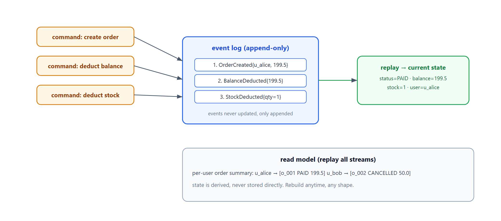
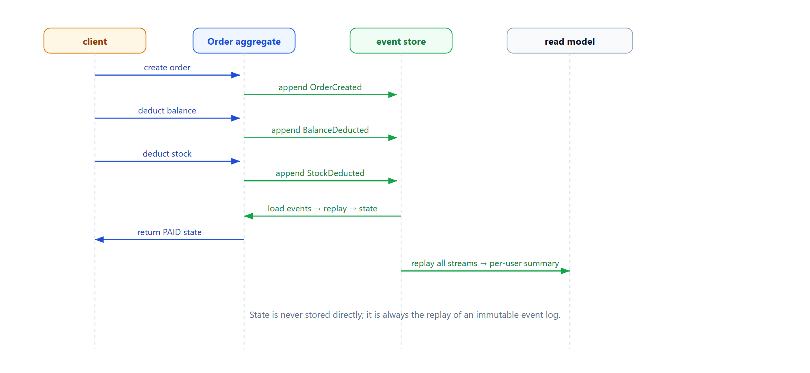

# Learn Event Sourcing — State as a Replay of Events

> **Learning / study repo. Self-contained demo, NOT production code.**
> Instead of storing the current state, store a sequence of events. The current state is
> always rebuilt by replaying those events. This gives full audit history and time travel.

## The idea

```
  commands:  create order  →  deduct balance  →  deduct stock
                  │              │                 │
                  ▼              ▼                 ▼
  event log:  OrderCreated   BalanceDeducted   StockDeducted   (append-only)
                  │              │                 │
                  └──────────────┴─────────────────┘
                                 ▼
                    current state = replay all events
```

- Never UPDATE a row. Only APPEND events.
- State is a *derived* view — rebuild it anytime by replaying the log.
- Full history for free: you can rebuild any past state, audit exactly what happened.
- Read models (e.g. per-user order summary) are built by replaying all streams.



## Why this pattern

- **Audit / time travel** — every change is an event; you can reconstruct any moment.
- **No lost updates** — events are immutable facts; no overwriting state.
- **Read models are flexible** — replay the log into any shape you need.
- **Naturally pairs with outbox / event bus** — events in the log are also published downstream.

## Run

```bash
python run_all.py
```

Pure Python standard library.

## Demo cases

1. **Lifecycle as events** — create order, deduct balance, deduct stock; state is replayed.
2. **Cancelled order** — append `OrderCancelled`, status becomes CANCELLED.
3. **Rebuild state from log** — fresh instance replays events and gets the same state.
4. **Read model** — replay all streams to build a per-user order summary.

## Flow



## Sibling repos

- `learn_outbox_pattern` — how these events get published reliably.
- `learn_event_fanout` — events fan out to downstream pipelines.
- `learn_distributed_txn` — cross-service consistency around the events.
